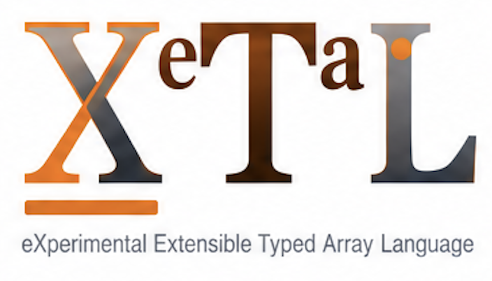

<h1>
  
  X_eTaL-RSI
</h1>

Recursive self-improvement (RSI) in
[X_eTaL](https://github.com/softwarewrighter/X_eTaL), the eXperimental
Extensible Typed Array Language: small, deterministic experiments in
which a system improves the harness it runs in, and then the procedure
by which it improves that harness, without changing a model's weights.

## The idea

The first architecture studied is Exo ("Exo: An Architecture for
Self-Improving Systems at Runtime", arXiv 2611.00463). A frozen model
drives an agent harness whose code, memory, tools and prompts are data
the agent may rewrite, and so is the policy that decides what to
rewrite. A protected layer the agent cannot change holds an
independent guardian, an append-only history and the authority to roll
back. The gains it reports are mostly efficiency: work done again
costs less because the system has built itself tools and procedures.

The question this repository asks is whether an array language makes
that loop cheaper, clearer and easier to verify:

- a policy is a small array program over a fixed, typed set of
  operations, so rewriting it is array manipulation, and the
  interpreter, the cost meter and the guardian stay out of its reach;
- the execution history is a table, so "which action sequences repeat,
  what do they cost, which fail" is an array expression, not a prompt;
- every change is a diff of a short program, checked by types and
  tests before it runs.

## Experiments

Each experiment runs against a control, with the ablation groups it
can tell apart (baseline, memory, tool learning, self-improving,
recursive), on deterministic simulated workloads. Simulations show
the mechanics of RSI; they are not evidence that a model learns, and
each one says so.

| # | Experiment | Status |
| - | ---------- | ------ |
| 01 | tool synthesis: repeated action sequences become tools | planned |
| 05 | specialization cost: when improvement pays, and a bounded budget | planned |
| 07 | guardian: defective revisions rejected or rolled back | planned |

The full list, the hypotheses and the roadmap are in
[docs/plan.md](docs/plan.md).

## Libraries

| Library | What | Status |
| ------- | ---- | ------ |
| Econ | the economics of specialization: break-even, budgets | planned |
| Journal | the event history as columns; repeated sequences and their cost | planned |
| Workshop | a deterministic electronics-assembly world worked by manipulator arms | planned |
| Policy | policies as op-code programs: run, compose, define tools | planned |
| Guardian | layered acceptance checks, versions and rollback | planned |

## Development

`just` lists the tasks; `just gate` is the pre-commit gate. Work is
planned as agentrail sagas (`agentrail status`); the decisions are in
[docs/plan.md](docs/plan.md), and what this repository needs from
X_eTaL is in [docs/xetal-asks.md](docs/xetal-asks.md). Changes are
listed in [CHANGES.md](CHANGES.md).

## Links

- Blog: [Software Wrighter Lab](https://software-wrighter-lab.github.io/)
- Discord: [Join the community](https://discord.com/invite/Ctzk5uHggZ)
- YouTube: [Software Wrighter](https://www.youtube.com/@SoftwareWrighter)

## Copyright

Copyright (c) 2026 Michael A Wright

## License

MIT. See [`LICENSE`](LICENSE) and [`COPYRIGHT`](COPYRIGHT).
